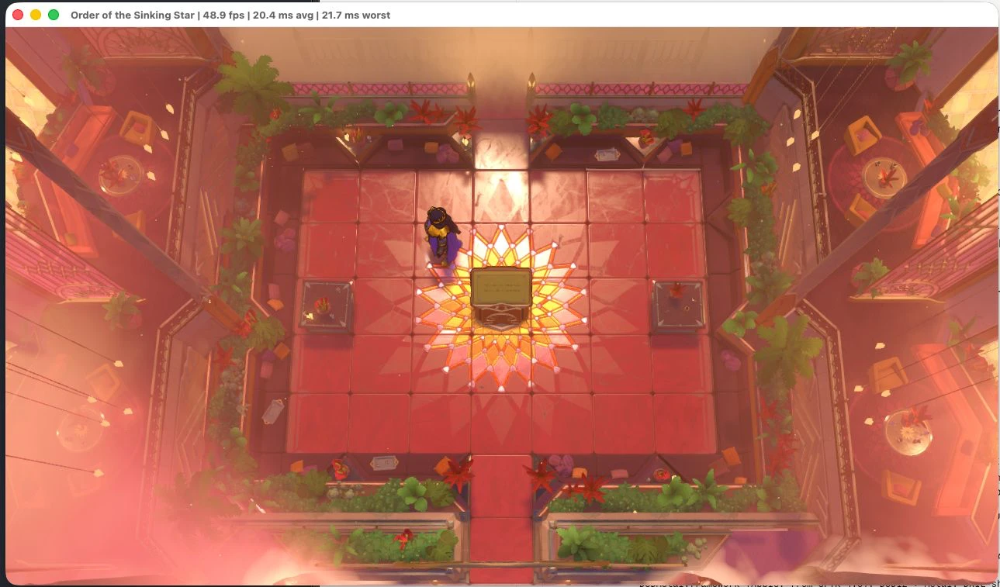

# Order of the Sinking Star on macOS

Runs the Windows build of *Order of the Sinking Star* on Apple Silicon Macs without Wine.



A small x86_64 loader maps `sinking_star.exe` into memory and implements the ~300 Windows functions it
imports on top of macOS: Cocoa for the window and input, CoreAudio for sound, and Apple's D3DMetal
(from the Game Porting Toolkit) for Direct3D 12. Everything runs under Rosetta 2.

## Requirements

- An Apple Silicon Mac with macOS 14 or later and Rosetta 2 (`softwareupdate --install-rosetta`)
- Xcode Command Line Tools, `meson` and `ninja` (`brew install meson ninja`)
- Your own copy of the game: the Windows build from Steam
- `D3DMetal.framework` from Apple's [Game Porting Toolkit](https://developer.apple.com/games/game-porting-toolkit/).
  It is Apple's and is not included here.

## Get the game files

Download the Windows build with your Steam account (Steam is not needed to play):

```sh
steamcmd +@sSteamCmdForcePlatformType windows +force_install_dir "$HOME/Games/Order of the Sinking Star" \
         +login <your_steam_user> +app_update <appid> validate +quit
```

## Get D3DMetal

Download the Game Porting Toolkit from Apple and find `D3DMetal.framework` in it. Then either copy it to
`build/D3DMetal.framework` after building, or point to it:

```sh
export D3DMETAL_FRAMEWORK_PATH=/path/to/D3DMetal.framework
```

If macOS quarantines it: `xattr -dr com.apple.quarantine D3DMetal.framework`.

## Build and run

```sh
make
make run GAME="$HOME/Games/Order of the Sinking Star"
```

`make` also fetches and builds [d3dmetal-native](https://github.com/utmapp/d3dmetal-native) (MIT), which
hosts D3DMetal outside Wine. Saves go to `~/Library/Application Support/Order of the Sinking Star`.

## Native D3D12 backend (work in progress)

`LOADER_D3D=native` replaces D3DMetal with our own D3D12 and DXGI on Metal (`src/d3d12/`), which would
remove the Apple dependency and the x86_64 restriction. It already creates the device, queues, fences,
swapchain (via `CAMetalLayer`), heaps, resources and descriptors, runs the game's whole frame loop and
records its commands. Shaders, pipelines and draws are not implemented yet, so nothing renders.

Shaders are translated from the game's own DXIL at run time by Apple's Metal Shader Converter
(`make msc` fetches it). The first launch converts all 257 of them, which takes a few seconds; the results
are cached in `~/Library/Caches/ootss-mac/shaders` (about 4 MB, keyed by the shader's hash and the converter
build) so later launches skip it. Delete that folder to force a fresh conversion. Nothing derived from the
game is stored in this repository or in the build.

## Options

| Variable | Effect |
| --- | --- |
| `LOADER_FPS=1` | Show fps and frame time in the window title |
| `LOADER_DISPLAY=native` | Report the real screen resolution to the game instead of the window size |
| `LOADER_TRACE=1` | Log Win32 calls (verbose) |
| `DMN_VSYNC=1` | Sync presentation to the display (off by default for lower input latency) |
| `MTL_HUD_ENABLED=1` | Apple's Metal performance HUD |

Turn off Low Power Mode when playing; it roughly halves the frame rate.

## Status

Playable with keyboard, mouse and sound. Not done: gamepads, Steam features (achievements, cloud
saves), the clipboard. Steam is stubbed as "running, offline".

## Layout

| File | Contents |
| --- | --- |
| `src/loader.c` | PE loader, import binding, TEB/TLS through `%gs`, crash reports, `main` |
| `src/win32.h` | The Windows types, structures and constants we use, size-checked against x64 Windows |
| `src/shim.h` | Shim registration (`SHIM(...)`), logging and shared declarations |
| `src/sync.c` | Threads, events, semaphores, waits, critical sections |
| `src/files.c` | Files, directory search, file mappings, console output |
| `src/kernel32.c` | Virtual memory, heaps, time, system information, modules |
| `src/crt.c` | Universal CRT and VCRUNTIME, including Windows `printf` and `setjmp` |
| `src/window.m` | Window, message queue and display metrics on Cocoa |
| `src/input.m` | Keyboard, mouse and Raw Input |
| `src/audio.c` | MMDevice/WASAPI on CoreAudio (for the game's Wwise) |
| `src/d3d.m` | D3D12/DXGI through D3DMetal |
| `src/misc.c` | Registry, COM, shell, dbghelp |
| `src/steam.c` | Steam, reported as running but offline |
| `src/strings.c` | UTF-16, path and printf helpers |

## Development

`make format` runs clang-format and `make lint` runs clang-tidy (`brew install llvm`).
`LOADER_TRACE=1` logs Win32 calls, and shims that are knowingly partial log their first calls as `[fixme]`.
